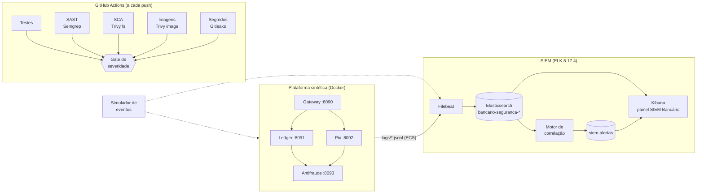

# Esteira DevSecOps Bancária

Esteira DevSecOps e SIEM caseiro para uma plataforma bancária **sintética**
(Gateway, Ledger, Pix e Antifraude em Flask). A cada push, o código passa por
SAST, varredura de dependências, de imagens e de segredos, e um **gate**
barra o merge quando sobra algum achado de severidade alta. Em execução, os
serviços gravam eventos de segurança que vão para um SIEM em ELK, onde
regras de correlação disparam alertas mostrados num painel no Kibana.

> Projeto de portfólio e estudo. Usa apenas dados sintéticos e IPs de faixas
> reservadas para documentação (RFC 5737). Não é um sistema de produção.

## Arquitetura



## Como rodar

Pré-requisitos: Docker Desktop (4 GB de RAM ou mais para o WSL), Python 3.12+
e Git. No Windows, use o PowerShell na raiz do repositório.

```powershell
# 1. Segredos aleatórios em siem/.env e servicos/.env (fora do git)
python scripts\gerar_env.py

# 2. SIEM: Elasticsearch, Kibana, setup e Filebeat
cd siem; docker compose up -d --wait; cd ..
python siem\scripts\verificar_siem.py          # esperado: 4 [OK]

# 3. Serviços sintéticos (portas 8090 a 8093, só em 127.0.0.1)
cd servicos; docker compose up -d --build; cd ..

# 4. Eventos: tráfego normal e os 4 cenários de ataque
python ferramentas\simulador_eventos.py --modo arquivo --cenario todos --semente 42
python siem\scripts\verificar_ingestao.py      # esperado: 5 [OK]

# 5. Correlação e painel
python siem\correlacao\motor.py                # esperado: alertas R001 a R004
python siem\kibana\provisionar_painel.py
```

Painel: <http://127.0.0.1:5601/app/dashboards#/view/siem-bancario>
(usuário `elastic`, senha em `siem/.env`).

Se o Elasticsearch não subir por causa do `vm.max_map_count`:
`wsl -d docker-desktop sysctl -w vm.max_map_count=262144`.

Testes e varredura local (os mesmos scanners do CI):

```powershell
python -m venv .venv; .\.venv\Scripts\Activate.ps1
pip install -r servicos\requirements-dev.txt
python -m pytest servicos\testes ci\testes siem\correlacao\testes -q   # 50 passed
powershell -ExecutionPolicy Bypass -File scripts\varredura_local.ps1   # ou: bash scripts/varredura_local.sh
python ci\gate_severidade.py                                           # APROVADO
```

## A esteira (`.github/workflows/devsecops.yml`)

| Job | Ferramenta | O que verifica |
|---|---|---|
| Testes unitários | pytest | serviços, gate e regras de correlação |
| SAST | Semgrep 1.181.1 | pacotes `p/python`, `p/flask`, `p/dockerfile`, `p/github-actions` e 9 regras bancárias próprias |
| SCA | Trivy 0.76.0 | CVEs em `servicos/requirements.txt` |
| Imagens | Trivy 0.76.0 | build das 4 imagens e CVEs com correção disponível |
| Segredos | Gitleaks 8.30.1 | todo o histórico do git, com `--redact` |
| **Gate de severidade** | `ci/gate_severidade.py` | decide se o merge passa |

Os scanners só coletam: cada um publica o relatório JSON como artefato e não
falha sozinho. Quem decide é o gate, com um critério único:

- **Semgrep:** severidade `ERROR` barra.
- **Trivy:** `HIGH` ou `CRITICAL` **com correção disponível** barra.
- **Gitleaks:** qualquer achado barra.

Exceções só em [`ci/excecoes.yml`](ci/excecoes.yml), com justificativa e data
de validade. Uma exceção vencida volta a barrar. Se um scanner falhar e o
relatório dele faltar, o gate sai com código 2 e também barra: falha de
ferramenta nunca vira aprovação silenciosa.

Regras bancárias do Semgrep ([`.semgrep/regras-bancarias.yml`](.semgrep/regras-bancarias.yml)):
dinheiro em `float`, dado sensível em log, Flask em modo debug, TLS
desligado, SQL concatenado, segredo com valor padrão, comparação de segredo
em tempo variável, hash fraco e `random` em contexto de segurança.

Proteção da `main` (exige o gate e os testes, PR e nada de force push):
`bash ci/proteger_branch.sh`, com o GitHub CLI autenticado como administrador.

## O SIEM

**Eventos.** Cada serviço grava um JSON por linha em `logs/<servico>.jsonl`,
com campos no padrão ECS (`event.action`, `event.outcome`, `user.id`,
`source.ip`, `bancario.valor_centavos`). A chave Pix e a conta de destino só
aparecem como pseudônimo HMAC, e o logger recusa campos de senha ou token.

**Ingestão.** O Filebeat lê `logs/*.jsonl` (montado somente leitura) e grava
no índice diário `bancario-seguranca-AAAA.MM.DD`, mantendo o horário
original do evento. O index template define dinheiro como `long`, IP como
`ip` e identificadores como `keyword`.

**Correlação** ([`siem/correlacao/`](siem/correlacao)). Regras como funções
puras, testadas sem Elasticsearch, com os parâmetros em
[`regras.yml`](siem/correlacao/regras.yml):

| Regra | Severidade | Dispara quando |
|---|---|---|
| R001 Tomada de conta | crítica | 5+ falhas de login do usuário em 10 min, login com sucesso e transferência ou Pix de R$ 10.000+ em até 30 min |
| R002 Força bruta por IP | alta | 20+ falhas de login do mesmo IP em 5 min |
| R003 Fracionamento de Pix | alta | 5+ Pix do mesmo usuário em 10 min somando R$ 10.000+ |
| R004 Conta laranja | alta | Pix de 5+ usuários diferentes para o mesmo destino em 30 min |

O motor grava cada alerta em `siem-alertas` com id determinístico (hash de
regra, chave e início da janela): reprocessar os mesmos eventos não duplica.

**Painel** "SIEM Bancário", provisionado por código
([`siem/kibana/provisionar_painel.py`](siem/kibana/provisionar_painel.py)):
total de alertas, alertas por regra e por severidade, linha do tempo dos
alertas, falhas de login ao longo do tempo, usuários com mais alertas, IPs
com mais falhas e a lista dos últimos alertas.

## Decisões de segurança

- **Menor privilégio no SIEM.** O Kibana usa `kibana_system`, nunca o
  `elastic`. O Filebeat entra como `filebeat_writer`, que só cria
  documentos e não lê nada. O motor entra como `siem_correlacao`, que lê os
  eventos e só grava alertas: não consegue alterar a evidência.
  `verificar_ingestao.py` prova as duas restrições (HTTP 403).
- **Segredos.** Só em `.env` fora do git, gerados por `scripts/gerar_env.py`.
  Nenhum segredo tem valor padrão no código: sem ele, o serviço não sobe.
  Uma regra do Semgrep garante isso.
- **Supply chain.** Scanners por imagem Docker de versão fixada, actions
  fixadas por SHA de commit, imagem base fixada por digest. O Trivy lê a
  imagem por `docker save`, em vez de receber o `docker.sock`.
- **Contêineres.** Usuário sem privilégios, sistema de arquivos somente
  leitura, `cap_drop: ALL`, `no-new-privileges`, portas presas em
  `127.0.0.1`. O pip é removido da imagem final: suas cópias embutidas de
  urllib3, msgpack e setuptools geravam 5 CVEs HIGH por imagem.
- **Dinheiro** sempre em centavos inteiros. Se o Antifraude não responder,
  a operação é negada.

## Limitações conhecidas

- TLS desligado entre os componentes do SIEM (portas só no loopback).
- O painel usa o usuário `elastic`. Um papel de analista somente leitura no
  Kibana fica como melhoria.
- O motor de correlação roda por linha de comando (`--continuo` para repetir);
  não há envio de notificação nem resposta automática a incidentes, que
  estão fora do escopo.
- A R001 agrupa as falhas por usuário, de qualquer IP. Uma força bruta em
  andamento pode somar falhas à janela de uma tomada de conta, e as
  evidências do alerta mostram isso.
- Depois de disparar, a regra esvazia a janela (rearme). O alerta lista os
  eventos até o limite, não os que vieram logo depois.
- O upload do SARIF para o Code Scanning depende de o repositório ser
  público ou ter GitHub Advanced Security.
- **Segredos em `.env` são uma simplificação do laboratório.** Em produção,
  viriam de um cofre (HashiCorp Vault, AWS Secrets Manager, Azure Key Vault)
  injetado no ambiente. Os serviços já leem tudo por variável de ambiente e
  não sobem sem os segredos, então a troca muda quem injeta, não o código.
- **A chave do HMAC de pseudonimização é única e não tem rotação.** Rotacionar
  sem cuidado quebra a correlação: a mesma chave Pix passaria a gerar outro
  pseudônimo, e a R004 deixaria de ver que é o mesmo destino. A evolução é
  versionar a chave (gravar no evento a versão usada), com uma janela de
  sobreposição entre a chave antiga e a nova.
- **O motor de correlação processa em lote** (`--continuo 60` = até 60 s de
  atraso). Em produção, o caminho seria processar em fluxo. Na licença básica
  do Elastic, a opção nativa são as regras EQL de sequência do Elastic
  Security. O Watcher exige licença paga, e por isso não foi usado.

## Estrutura

```
.github/workflows/devsecops.yml   esteira: testes, SAST, SCA, imagens, segredos e gate
.semgrep/                         9 regras bancárias e seus casos de teste
ci/                               gate de severidade, exceções, proteção da main e testes
scripts/                          gerar_env.py e varredura local (.sh e .ps1)
servicos/                         Gateway, Ledger, Pix e Antifraude (Flask), Dockerfile e testes
siem/                             compose do ELK, setup, Filebeat, correlação, painel e verificações
ferramentas/simulador_eventos.py  tráfego normal e cenários de ataque
docs/RETOMADA.md                  histórico das etapas e decisões
```
